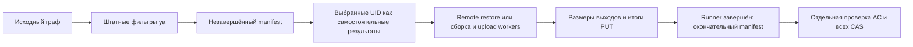

# Manifest прогрева bazel-кеша

Manifest содержит выбранные выходы сборки и итоги попыток PUT. Его пишет тот же ya,
который строит граф и выполняет сборку. Библиотека использует только стандартную
библиотеку Python; HTTP, runner и Tasklet SDK в её зависимостях отсутствуют.

**`complete: true` означает завершённую запись manifest.** Даже `put_status: "ok"`
не доказывает наличие данных в кеше: клиентская запись может завершиться без
сохранённого AC или всех CAS. Прогреватор должен отдельно прочитать AC и каждый CAS,
проверить SHA-256, размер и наличие ожидаемых выходов.

## Подключение к ya make

Включите native режим прогрева и добавьте параметры манифеста:

```bash
/path/to/matching/ya-bin --no-respawn --no-new-pgroup make project -r -j4 \
    --no-yt-store --bazel-remote-store --bazel-remote-put \
    --bazel-remote-base-uri=http://cache:8080/ --bazel-remote-warming \
    --bazel-remote-warming-manifest=/private/run/manifest.json \
    --bazel-remote-warming-run-id=unique-run-id
```

Нужен ya-bin с поддержкой этих параметров. Прогреватор и Tasklet выбирают
единый релизный комплект либо предсобирают все инструменты из указанной ветки.
Поддержка режима прогрева и манифеста проверяется у выбранного ya до основного прогрева.
Ревизия checkout сама по себе не определяет версию ya, которую выберет `./ya`.

Manifest рассчитан на Linux и macOS: чтение и атомарная запись используют POSIX.
На Windows новые параметры отклоняются; сборка без них сохраняет прежнее поведение.

Manifest разрешён только для локального `ya make` с записью в Bazel и положительным
целым числом сборочных потоков. Путь к файлу и run_id должны быть непустыми.
Готовый граф/контекст, distbuild, Larry, только конфигурация,
предиктивная статистика и игнорирование кодов ошибок отклоняются. Параметры manifest
не загружаются из пользовательского ya.conf. Без этих двух параметров обычное
поведение кеша сохраняется.

## Что входит в план

ya применяет действующие фильтры BazelStore и результатов сборки. Native прогрев
сохраняет выбранные UID как самостоятельные результаты графа, включая зависимости
уже закешированного родителя. Каждый выбранный кешируемый результат восстанавливается из удалённого кеша;
при промахе или неполном CAS выполняется локальная сборка и повторная запись.
Локальное попадание и HEAD=200 не исключают выбранный UID из этой проверки.
Фильтры программ, инструментов, bundle, запусков тестов, специальных узлов и
дополнительных результатов вычисляет ya; библиотека их не повторяет.

Для каждого выбранного узла сохраняются UID, ожидаемые относительные пути выходов,
признак `cacheable` и итог PUT. Узлы с `cacheable: false` учитываются в плане,
но не объявляются прогретыми. Команды графа, окружение и содержимое секретов
в manifest не записываются.



## Формат версии 1

| Поле | Значение |
| --- | --- |
| `schema_version` | Целое число `1` |
| `run_id` | Идентификатор текущего запуска: 1–128 латинских букв, цифр или символов `_`, `.`, `-` |
| `max_file_size` | Фактический лимит PUT одного файла в байтах; `0` отключает лимит |
| `complete` | `false` до завершения runner, `true` после записи окончательного документа |
| `build_exit_code` | `null` в незавершённом документе; фактический неотрицательный код ya в окончательном |
| `nodes` | Список выбранных узлов; UID не повторяются |
| `local_cache` | Необязательные `kind` и абсолютный `path` локального кеша; добавляются прогреватором для процесса догрузки |

Узел содержит `uid`, непустой список `outputs`, `cacheable`, `put_status`
и `written_files`. Элемент `written_files` содержит относительный `path` и размер
`size` в байтах. Размеры снимаются до освобождения build root.

Необязательное поле `build_error` служит внутренней аннотацией прогреватора:
оно содержит подтверждённую штатными отчётами ошибку конкретного UID.
Нативный writer его не записывает; исходный документ остаётся неизменным.
Для HTTP-проверки прогреватор сохраняет отдельный документ без несобранных узлов.

| `put_status` | Требуется проверка AC/CAS |
| --- | --- |
| `not_attempted` | Да: например, результат успешно восстановлен без повторного PUT |
| `ok` | Да: статус клиента ещё не подтверждает сохранённые данные |
| `failed` | Да: в кеше может сохраниться ранее записанный полный результат |
| `skipped_size` | Нет: весь узел пропущен из-за выходного файла больше лимита |

`skipped_size` принимается только при положительном `max_file_size`, наличии всех
ожидаемых выходов в `written_files` и размере хотя бы одного файла строго больше
лимита. Отсутствующий AC без такого свидетельства означает неполный прогрев.
Узлы с `cacheable: false` всегда исключаются из требуемого набора.

Сам манифест можно включить без `--bazel-remote-warming`, сохранив обычный выбор
результатов. Прежний `--dist-cache-evict-cached` исключает результаты только по HEAD
и не ремонтирует потерянный CAS; общий прогреватор этот режим не использует.

## API и обработка отказов

[model.py](model.py) задаёт независимые модели `Manifest`, `Node`, `WrittenFile`
и чтение документа. `read_manifest(path, expected_run_id)` принимает только окончательный
документ текущего запуска. Чтение отклоняет неизвестную версию, лишние/пропущенные
поля, повторные JSON-ключи и UID, небезопасные пути и symlink/FIFO.
Конфликт файла с его потомком, например `out` и `out/extra`, тоже недопустим.

Размер манифеста не ограничен. При чтении корректного документа каждый узел сразу
преобразуется в модель, без промежуточного дерева JSON всего документа.
В памяти остаются итоговая модель и буфер разбираемого узла; расход зависит
от числа результатов, файлов и длины строк.

[writer.py](writer.py) создаёт приватный файл `0600`. Сначала он заменяет старый
результат незавершённым документом нового запуска. `select(nodes)` фиксирует план,
`record_put(uid, status, root_dir, files)` сохраняет итоги выбранных узлов,
`finish(build_exit_code)` завершает документ после runner. Посторонние зависимости
не расширяют план. Обращения параллельных upload workers защищены одним lock.

Описание `local_cache` добавляется общей библиотекой прогрева в документы процесса
догрузки по записи в журнале ya. Его отсутствие не препятствует проверке кеша:
при необходимости прогрев выполнит досборку. TTL, LRU и ограничение размера
могут удалить локальный набор файлов до восстановления.

Запись использует временный файл в том же каталоге, `fsync`, `replace` и `fsync`
каталога. Ошибка записи или сбора размеров не скрывается; ya завершается с ошибкой.
При обрыве записи reader не принимает обрезанный JSON. При аварии после атомарной
замены файл уже может содержать `complete: true`; прогреватор обязан также проверять
штатное завершение дочернего ya и соответствие `build_exit_code`. Ненулевой код
допускает частичный прогрев только при подтверждённых ошибках выбранных узлов.

Manifest не обеспечивает сохранность кеша после проверки. TTL, LRU и параллельные
клиенты могут изменить данные. Для штатного асинхронного S3 один успешный PUT также
не гарантирует доступность через другой вход: требуется отдельное холодное чтение.

Пути содержат корректный Unicode; имя каждого файла или каталога занимает не больше 255 байт в UTF-8. Это переносимое ограничение для Linux/macOS. Достижимость всего пути зависит от длины абсолютного build root потребителя; manifest не подтверждает восстановление на любой файловой системе.
